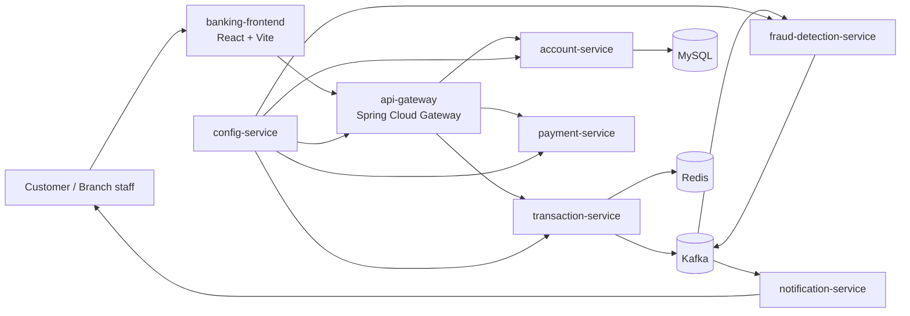
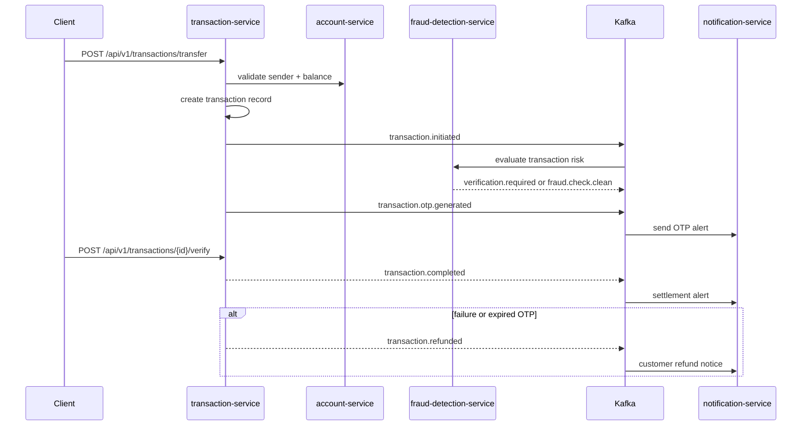

# FutureTrust Bank — Distributed Digital Banking Platform

A distributed banking platform that demonstrates how a modern digital bank can combine account management, secure money movement, fraud monitoring, event-driven integration, and customer alerting across multiple Spring Boot services.

This repository is the backend and frontend implementation of a demo system built around the real operating patterns of a bank: protected transfers, OTP verification, risk checks, account lockouts, notification events, and compensation when a transaction must be reversed.

## Overview

FutureTrust Bank is modeled as a microservice ecosystem with clear domain ownership:

- Account management and balance tracking live in the account domain.
- Transfer orchestration and verification live in the transaction domain.
- Fraud detection and velocity checks are handled as independent risk workflows.
- Payment outcomes and downstream settlement events are emitted asynchronously.
- Customer alerts are sent by a notification service driven by Kafka events.
- The frontend is a React application that presents the bank experience without exposing the internal service choreography.

The repository intentionally keeps technical internals visible in code and infrastructure, while the UI presents them as a polished banking experience.

## Architecture summary



## Service map

| Service | Purpose | Port | Notes |
| --- | --- | --- | --- |
| `config-service` | Spring Cloud Config server | 8888 | Loads configuration from the `config-repo` Git-backed repository |
| `api-gateway` | Unified external API entry point | 8080 | Routes requests to account, transaction, and payment services |
| `account-service` | Account lifecycle, balances, activation/blocking | 8081 | Owns account state and balance mutation |
| `transaction-service` | Transfer orchestration, OTP checks, expiry handling | 8082 | Publishes Kafka events and manages transaction status |
| `fraud-detection-service` | Transaction risk evaluation | 8084 | Checks velocity, unusual amounts, and balance-based anomalies |
| `payment-service` | Payment settlement and event completion | 8083 | Emits payment success/failure signals |
| `notification-service` | Alerts and customer notifications | 8085 | Consumes Kafka topics for OTP, fraud, and refund events |
| `banking-frontend` | React banking dashboard and landing experience | 5173 (dev) | Uses Redux state and mock fallback logic when backend is unavailable |

## Technology stack

| Layer | Stack |
| --- | --- |
| Runtime | Java 21, Spring Boot 3.3.x |
| API Gateway | Spring Cloud Gateway |
| Service orchestration | Spring Boot, REST, `@RestController`, Kafka integration |
| Persistence | MySQL, Redis |
| Messaging | Apache Kafka + ZooKeeper |
| Observability | Prometheus, Grafana |
| Frontend | React 19, Vite, Redux Toolkit, React Router, Tailwind CSS |
| UI motion | Framer Motion |
| HTTP client | Axios |
| Build tooling | Maven, npm |

## Domain behavior and business flow

### 1. Account creation and balance validation

The account domain owns the master record for customers and balances. A transfer begins by validating that the sender account exists, is active, and has enough available funds.

### 2. Transfer initiation

When a transfer is submitted, the transaction service:

1. Validates the amount and sender/receiver pair.
2. Checks Redis-based lockout state for the sender account.
3. Calls the account service to confirm the balance and reserve funds.
4. Persists the transaction record.
5. Publishes a `transaction.initiated` event to Kafka.

### 3. Fraud screening

The fraud-detection service listens to the transaction start event and evaluates patterns such as:

- rapid transfer velocity in a short time window
- unusually large amounts relative to historical activity
- transactions consuming a high percentage of available balance

If a risk pattern is found, the service emits `verification.required` and the transaction workflow pauses for stronger customer verification.

### 4. OTP verification and lockout

The transaction workflow stores OTPs in Redis with a time-to-live. If the customer enters the wrong code:

- the wrong attempt count is increased
- the account is temporarily locked after several failures
- status is updated to notify the system that the transfer must be reversed or rejected
- a security alert is sent through Kafka

This protects against brute-force abuse and improves confidence in payment safety.

### 5. Completion and compensation

On successful verification, the transaction is marked complete and a `transaction.completed` event is emitted. If the process fails or the OTP expires, the system executes a compensating refund flow and emits `transaction.refunded` so ledger-side state remains consistent.

## SAGA-style workflow



## API surface

The platform exposes its service APIs through the gateway on port `8080`. These are the core paths currently implemented in the codebase.

| Operation | Endpoint | Purpose |
| --- | --- | --- |
| Create account | `POST /api/v1/accounts` | Create a new account |
| Get account | `GET /api/v1/accounts/{accountNumber}` | Fetch account details |
| Get balance | `GET /api/v1/accounts/{accountNumber}/balance` | Return account balance and status |
| Activate account | `PUT /api/v1/accounts/{accountNumber}/activate` | Activate a dormant account |
| Block account | `PUT /api/v1/accounts/{accountNumber}/block` | Lock an account |
| Update status | `PATCH /api/v1/accounts/{accountNumber}/status` | Transition the account status |
| Transfer funds | `POST /api/v1/transactions/transfer` | Submit a transfer request |
| Get transaction by id | `GET /api/v1/transactions/{id}` | Fetch a transaction record |
| Get transaction by reference | `GET /api/v1/transactions/reference/{referenceNumber}` | Query by transfer reference |
| Get account transactions | `GET /api/v1/transactions/account/{accountNumber}` | List transaction history |
| Verify transaction | `POST /api/v1/transactions/{transactionId}/verify?otp=...` | Validate OTP and complete transfer |

## Kafka topics and event flow

The repository uses the following primary Kafka topics:

| Topic | Producer | Consumer | Purpose |
| --- | --- | --- | --- |
| `transaction.initiated` | transaction-service | fraud-detection-service | Starts the risk-evaluation workflow |
| `verification.required` | fraud-detection-service | transaction-service | Forces step-up verification when a transaction looks risky |
| `fraud.check.clean` | fraud-detection-service | transaction-service | Allows transfer to continue when risk checks pass |
| `fraud.detected` | transaction-service | account-service, notification-service | Marks a fraud signal or suspicious event |
| `transaction.otp.generated` | transaction-service | notification-service | Sends OTP or verification notifications |
| `transaction.completed` | transaction-service | account-service, notification-service | Confirms a completed transfer |
| `transaction.refunded` | transaction-service | account-service, notification-service | Reverses or compensates failed or flagged flows |
| `security.alert` | transaction-service | notification-service | Sends lockout and security alerts |
| `payment.completed` | payment-service | notification-service | Confirms downstream payment completion |
| `payment.failed` | payment-service | notification-service | Signals settlement failure |

## Redis usage

Redis is used for fast-moving operational state rather than core customer records:

| Key pattern | Purpose |
| --- | --- |
| `lockout:account:{accountNumber}` | Temporary lock triggered by repeated invalid OTP attempts |
| `otp:attempts:{accountNumber}` | Tracks OTP failure count |
| `verification:otp:{transactionId}` | Stores the active OTP for a given transfer |
| `fraud:velocity:{accountNumber}` | Tracks rapid transfer volume |
| `fraud:average-amount:{accountNumber}` | Tracks recent average amount for anomaly detection |

## Infrastructure and local environment

The local environment is defined in `docker-compose.yml` and includes:

- Zookeeper
- Kafka
- Redis
- MySQL
- config-service
- Prometheus
- Grafana

### Start infrastructure

```bash
docker compose up -d
```

### Run backend services

From the repo root:

```bash
mvn clean install
mvn spring-boot:run -pl config-service
mvn spring-boot:run -pl api-gateway
mvn spring-boot:run -pl account-service
mvn spring-boot:run -pl transaction-service
mvn spring-boot:run -pl fraud-detection-service
mvn spring-boot:run -pl payment-service
mvn spring-boot:run -pl notification-service
```

### Frontend

```bash
cd banking-frontend
npm install
npm run dev -- --host 0.0.0.0 --port 5173
```

The frontend uses the following environment variables:

```env
VITE_API_BASE_URL=http://localhost:8080/api
VITE_USE_MOCK=true
```

When the backend is unavailable or the app is running in mock mode, the frontend automatically falls back to seeded account and transaction demo data.

## Project structure

```text
banking-system/
├── account-service/
├── api-gateway/
├── banking-frontend/
├── config-repo/
├── config-service/
├── fraud-detection-service/
├── mysql-init/
├── notification-service/
├── payment-service/
├── transaction-service/
├── ARCHITECTURE.md
├── README.md
├── docker-compose.yml
├── pom.xml
├── prometheus.yml
└── .gitignore
```

## Observability and operations

- Prometheus is exposed at `http://localhost:9090`
- Grafana is exposed at `http://localhost:3000`
- The gateway is exposed at `http://localhost:8080`
- MySQL is exposed at `localhost:3306`
- Kafka is exposed at `localhost:9092`
- Redis is exposed at `localhost:6379`

## Security and design notes

This repository is a learning and demonstration platform. It shows patterns commonly used in secure digital banking systems, especially around:

- transaction step-up verification
- locked account recovery workflows
- event-driven processing
- compensation and refund handling
- fraud review and alerting
- observability of asynchronous operational flow

The app is deliberately structured to separate concerns so that business rules, messaging, and customer experience remain independent.

## Documentation map

- [ARCHITECTURE.md](ARCHITECTURE.md) — system-level design and service responsibilities
- [banking-frontend/README.md](banking-frontend/README.md) — React app overview and frontend runtime behavior

## Summary

FutureTrust Bank demonstrates a realistic, real-time banking architecture that combines payment orchestration, distributed state, and fraud defense. The system is designed to be understandable, event-driven, and close to the patterns used in production-grade digital banking applications.
